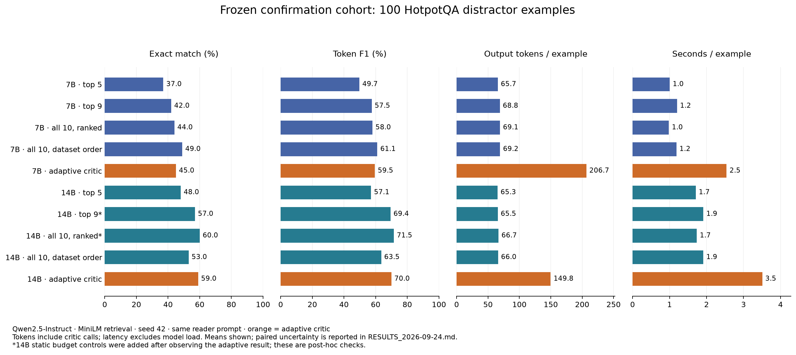

# Research interpretation and next steps

## What this study can answer

We compare reader, retrieval and sufficiency decisions within HotpotQA's
distractor setting: ten supplied paragraphs per question. The original50 is
exploratory and has been repeatedly examined; the disjoint100 manifest was
frozen before the new development results. Prompts and thresholds were not
tuned on confirmation outcomes. Neither cohort is the hidden official test.

The complete measurements and paired bootstrap intervals are in
[RESULTS](RESULTS_2026-09-24.md). All configurations, including regressions, are
reported. Additional static top9/ranked-all controls were specified after the
exploratory results but before viewing confirmation outcomes.
The corresponding 14B top9/ranked-all controls were added after observing its
confirmation result, and are explicitly post-hoc mechanism checks.

Adaptive runs share one checkpoint between critic and reader. A 7B→14B
comparison changes both roles and potentially the retrieved evidence sequence;
it does not isolate reader scale from controller quality. All-context model
comparisons isolate scale more directly because their evidence is identical.

## Measured outcome

**The simplest strong configuration won the observed cost–accuracy comparison.**
On the same fresh100 questions, Qwen2.5-14B with all ten paragraphs in retrieval
order achieved 60% EM / 71.51% F1, versus 59% / 69.95% for its adaptive critic.
It used 66.7 rather than 149.8 output tokens and 1.74 rather than 3.51 seconds
per question. This static control was added post hoc, so it is a candidate for
replication, not an independently confirmed best configuration.

| Configuration on confirmation100 | EM | F1 | Output tokens | Seconds |
|---|---:|---:|---:|---:|
| 7B, top5 | 37% | 49.73% | 65.7 | 1.01 |
| 7B, top9 | 42% | 57.54% | 68.8 | 1.20 |
| 7B, all10 ranked | 44% | 58.04% | 69.1 | 0.98 |
| 7B, all10 dataset order | 49% | 61.07% | 69.2 | 1.19 |
| 7B, adaptive | 45% | 59.50% | 206.7 | 2.54 |
| 14B, top5 | 48% | 57.09% | 65.3 | 1.71 |
| 14B, top9 (post hoc) | 57% | 69.41% | 65.5 | 1.91 |
| 14B, all10 dataset order | 53% | 63.53% | 66.0 | 1.91 |
| 14B, all10 ranked (post hoc) | 60% | 71.51% | 66.7 | 1.74 |
| 14B, adaptive | 59% | 69.95% | 149.8 | 3.51 |

The key paired EM comparisons are:

- 7B adaptive versus top5: **+8 points**, 95% interval **+1 to +15**.
- 7B adaptive versus all10 dataset order: **−4 points**, **−13 to +5**.
- 14B adaptive versus all10 dataset order: **+6 points**, **−1 to +13**.
- 14B adaptive versus top9: **+2 points**, **−2 to +6** (post-hoc control).
- 14B adaptive versus all10 ranked: **−1 point**, **−7 to +5** (post-hoc control).
- 14B versus 7B with identical all10 retrieval order: **+16 points**,
  **+8 to +25** (post-hoc model comparison).

Intervals use paired resampling and are not adjusted for multiple comparisons.
The adaptive-versus-strong-static intervals include zero. This does not prove
the methods are equivalent, but it leaves no established adaptive benefit to
justify the additional calls here. Model capacity and evidence presentation
are stronger leads than the current untrained critic.

Twenty-three new evaluation arms produced 1,650 scored predictions across
**150 unique dev questions**, plus separate train smoke checks. Five historical
arms remain in the full 28-arm report. Reusing a question across arms does not
create additional independent examples. No new evaluation arm had an execution
failure; parse/schema/empty-answer problems are reported separately.

## Lessons from the papers, applied to this system

1. **Relevance and sufficiency are different.** Google's
   [Sufficient Context work](https://arxiv.org/abs/2411.06037) motivates asking
   whether the evidence establishes the complete answer. Our king/empire
   example retrieves a relevant document but misses the predecessor relation.
   However, merely adding a prompted critic does not make it reliable. The
   critic must itself be evaluated, and an adequate context still does not
   guarantee correct generation.
2. **Context enrichment needs the right corpus.**
   [Anthropic's method](https://www.anthropic.com/engineering/contextual-retrieval)
   uses the parent document to contextualize each chunk before dense and BM25
   indexing. Our title prefix is a limited metadata baseline. Full parent
   Wikipedia articles are absent here, so we cannot claim to reproduce the
   complete method or inherit its reported retrieval improvement.
3. **Adaptive retrieval must beat a fair static budget.**
   [IRCoT](https://aclanthology.org/2023.acl-long.557/) motivates evidence-dependent
   queries. But our adaptive arm can read nine paragraphs while top5 reads five.
   Better accuracy against top5 alone cannot establish that the critic or query
   rewriting caused the gain. Top9 and all-ten controls test that explanation.
4. **Training methods are not prompt features.** DREAM, EvoEmbedding, MCompassRAG,
   environment-aware query rewriting, Self-RAG and CRAG contain learned
   components/objectives that this experiment does not reproduce. The
   [literature table](RESEARCH_REVIEW_2026-09-24.md) identifies the distinctions.
5. **A vector database is infrastructure.** Changing where the same vectors are
   stored does not improve their semantic representation. Exact NumPy ranking
   is adequate for these ten candidates. A database becomes useful for a large,
   persistent corpus, filters and updates; then retrieval recall and approximate
   search losses need separate evaluation.

## Verified qualitative findings

- The legacy answer selector sometimes discards a later correct answer, but in
  other cases protects an earlier correct answer from later drift. Neither
  lexical confidence nor always choosing the final hop is generally reliable.
- The former deterministic candidate verifier reduced EM from 56% to 46% on
  original50. Its previously reported unchanged score was a reporting error,
  now corrected in the log and source artifacts.
- Some EM failures are aliases, units or answer-span differences. One inspected
  question asks for a river while its gold answer names an animal. Scores remain
  unchanged; these observations require independent review before any secondary
  semantic scoring is used.
- Valid citation addresses do not prove support. A 14B response cites another
  state's legislature when answering a Florida Senate question; its explanation
  even acknowledges the missing evidence.
- Conversely, missing an annotated paragraph does not always mean insufficient
  evidence: an already retrieved sentence may directly contain the answer.
  Therefore support coverage is a proxy, not a gold sufficiency classifier label.

See [the manual case review](ERROR_REVIEW_2026-09-24.md) and
[critic decision diagnostics](CRITIC_DIAGNOSTICS_2026-09-24.md).

The [embedding-length audit](EMBEDDING_AUDIT_2026-09-24.md) found overflow in
17/500 original50 and 41/1000 confirmation100 paragraphs for plain MiniLM, but
none were gold-title paragraphs. BGE original50 overflowed two distractors and
no gold paragraphs. Thus encoder truncation exists, but these results do not
support it as an explanation for losing the gold evidence in these runs.

## What to preserve in the implementation

One measured cost improvement is concrete: on original50, the short 7B
all-context reader and chat-formatted legacy fixed-hop reader both score 52% EM.
The short reader uses 74.4 rather than 351.4 output tokens per question and
1.41 rather than 5.01 seconds: about 79% fewer output tokens and 72% lower
observed latency. Their predictions are not identical (two EM gains and two
losses), and the paired EM interval is −8 to +8 points. This is an observed
cost reduction on a small exploratory cohort, not proof of general accuracy
equivalence or a controlled hardware throughput benchmark.

The matched current raw-prompt control scores 54% EM / 64.22% F1 versus the
chat-formatted control's 52% / 64.35%. Thus applying the correct chat template
does not itself establish an accuracy improvement; it substantially reduces
the tendency to consume the full generation budget. The older historical
raw-prompt run (56% / 66.22%) is a different revision and remains in the report.
Of 150 matched raw hop outputs, none is strict JSON and all hit the 192-token
budget; 143 still contain a recoverable complete object. Chat formatting yields
143 strict objects and only two budget hits. Both have seven outputs without a
recoverable complete object under the new object parser. The legacy regex
fallback can nevertheless recover answer fields, explaining why its reported
parse-failure metric alone concealed this distinction.

The stronger BGE+title+hybrid top5 retriever scores 58% EM on original50, versus
52% for MiniLM+title+hybrid and 46% for plain MiniLM. The matched embedder change
has three gains and no losses, but its 95% EM interval includes zero. This is a
promising exploratory retrieval result, not a confirmed improvement on fresh100.

Keep the model's official chat format, explicit input budget, model-isolated
embedding cache, exact frozen manifests, sentence-addressed evidence, complete
generation traces and paired analysis. These make failures observable and
experiments reproducible even when a proposed method loses.

The shorter reader is a useful control. Its lower generation cost must be
attributed to its prompt, number of calls and observed output lengths, not to
within-answer reasoning stopping: that mechanism is not used in the new arms.
The old pipeline remains executable, with comments explaining the displaced
selection/truncation behavior, rather than a large inactive code copy.

## Next research direction, with a stopping rule for the research itself

1. **Lock a simple baseline first.** Use the completed static-reader controls as
   the reference. Do not keep optimizing the old50 until a desired number appears.
2. **Test at a scale where retrieval is necessary.** Add a full-corpus setting
   and another multi-hop dataset. Preserve full parent documents and chunk
   addresses; compare dense, BM25/hybrid, contextualized chunks and a suitable
   reranker using the same reader. Measure evidence coverage as well as EM/F1.
3. **Train a relation-aware critic on train only.** Construct partial contexts
   with missing first/second relations, irrelevant but plausible entities, and
   sufficient alternative evidence. Use adjudicated or validated teacher labels;
   gold-title coverage alone is insufficient. Calibrate any threshold on a
   separate train-derived validation split, not the reported dev examples.
4. **Verify the requested answer relation.** A verifier should distinguish a
   king's empire from its predecessor and a town from its population. Require
   support for the relation and answer type, not merely the answer string's
   presence. Check answer/explanation disagreement explicitly. A concrete
   engineering hypothesis is to extract cited facts plus an operation, then
   execute simple comparisons/intersections deterministically: compare 1944
   with 1945, or intersect the casts of two works. Keep the model responsible
   for grounded fact extraction, and test whether this avoids fluent but
   contradictory final answers. This is proposed future work, not an
   implemented or validated improvement in the current runs.
5. **Compare under equal budgets.** Include static context expansion, query
   rewriting without a critic, critic without rewriting, and a trained critic.
   Count every model call and input/output token; evaluate cost–accuracy curves.
6. **Predefine the decision.** Before a fresh test, specify the minimum useful
   accuracy/cost gain and required uncertainty. If adaptive control does not beat
   the strong static controls, keep the simpler system and report the negative
   result. Do not label it a novel superior model based on a selected subset.

The plausible contribution is a carefully evaluated way to identify and repair
missing evidence relations under a budget. Closely related prior art already
exists. Novelty and a market-wide advantage are **not established** by this study.
